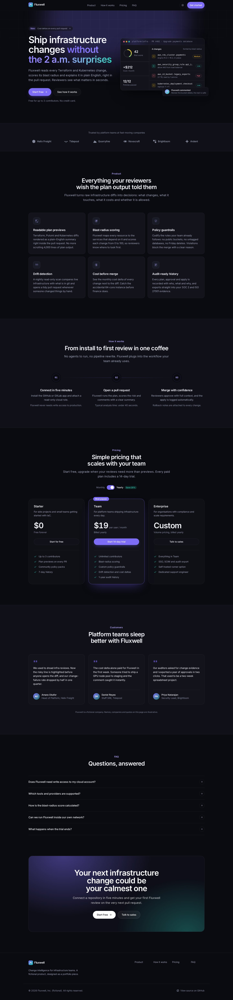
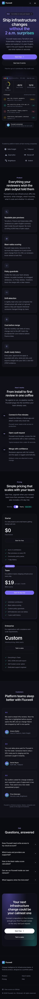

# Fluxwell — landing page

A marketing landing page for **Fluxwell**, a **fictional** startup that reviews infrastructure changes (Terraform, Pulumi, Kubernetes) before they reach production. Fluxwell, its customers, logos, testimonials and prices are all invented for this project; nothing here refers to a real company.

Built as a front-end showcase: a premium, fully responsive single page with light and dark themes, written in React + TypeScript + Tailwind CSS with no UI kit and no stock imagery. The product visual is drawn entirely in HTML, CSS and SVG.

| Desktop (1440 px, dark)                                                                                                    | Mobile (iPhone 13, WebKit)                                                                                               |
| -------------------------------------------------------------------------------------------------------------------------- | ------------------------------------------------------------------------------------------------------------------------ |
|  |  |

Light theme: [desktop](docs/desktop-light.jpg) · [mobile](docs/mobile-light.jpg)

## Stack

- [Vite 7](https://vite.dev) for dev server and build
- [React 19](https://react.dev) with TypeScript (strict, `noUncheckedIndexedAccess`)
- [Tailwind CSS v4](https://tailwindcss.com) via `@tailwindcss/vite`, with design tokens in CSS variables
- ESLint 9 (flat config) with `typescript-eslint` strict, `react-hooks` and `jsx-a11y`
- Prettier with the Tailwind class-sorting plugin
- Inter (self-hosted through `@fontsource-variable/inter`, no third-party requests)

Runtime dependencies are just React, React DOM and the font package.

## Getting started

Requires Node.js 20.19 or newer.

```bash
npm install
npm run dev        # http://localhost:5173
```

| Script              | What it does                               |
| ------------------- | ------------------------------------------ |
| `npm run dev`       | Start the Vite dev server                  |
| `npm run build`     | Type-check (`tsc -b`) and build to `dist/` |
| `npm run preview`   | Serve the production build locally         |
| `npm run lint`      | Run ESLint                                 |
| `npm run typecheck` | Type-check without emitting                |
| `npm run format`    | Format the codebase with Prettier          |

## Project structure

```
src/
├── App.tsx                    # Page composition and skip link
├── main.tsx                   # React entry point
├── index.css                  # Tailwind import, theme tokens, base styles
├── types.ts                   # Shared content types
├── data/
│   └── content.ts             # All copy: nav, features, steps, plans, testimonials, FAQ
├── hooks/
│   └── useTheme.ts            # Light/dark state synced with <html> and localStorage
└── components/
    ├── layout/                # Navbar (with accessible mobile menu), Footer
    ├── sections/              # Hero, LogoStrip, Features, HowItWorks, Pricing,
    │                          # Testimonials, Faq, FinalCta
    ├── ui/                    # Button, Container, Icon, Logo, SectionHeading, ThemeToggle
    └── visuals/
        └── ProductMockup.tsx  # The hero product visual, pure HTML/CSS/SVG
```

Content lives in `src/data/content.ts`, typed by `src/types.ts`, so sections stay presentational and copy changes never touch markup.

## Design and implementation notes

- **Theming.** Semantic colours (`canvas`, `surface`, `ink`, `muted`, `line`…) are Tailwind theme variables that a single `.dark` class on `<html>` swaps. A tiny inline script in `index.html` applies the saved or system theme before first paint, so there is no flash on load.
- **Accessibility.** Semantic landmarks and one `h1`; every section is labelled by its heading; skip-to-content link; visible `:focus-visible` rings; the mobile menu exposes `aria-expanded` / `aria-controls` and closes on Escape; the billing toggle is a real `role="switch"`; the FAQ uses native `<details>` / `<summary>`; decorative SVGs are `aria-hidden` and the product visual has a text description. Text colours were chosen for WCAG AA contrast in both themes.
- **Motion.** Micro-interactions are short CSS transitions. Ambient animations use Tailwind's `motion-safe:` variant, and `prefers-reduced-motion: reduce` disables transitions and smooth scrolling globally.
- **Responsive.** Mobile-first layouts tested at 320, 390 and 1440 px wide with no horizontal scrolling. Grid tracks use `minmax(0, 1fr)` so long monospace resource names truncate instead of stretching the layout.
- **No backend.** Calls to action link to in-page sections (and a placeholder `.example` sales address), since there is no real product to sign up for.

## Quality checks

- `npm run build` completes with no TypeScript errors or build warnings
- `npm run lint` passes with zero warnings
- Screenshots in `docs/` were captured in WebKit (iPhone 13 profile) and Chromium (1440 × 900) from the production build

## License

MIT. Fluxwell is a fictional brand created for this portfolio project.
